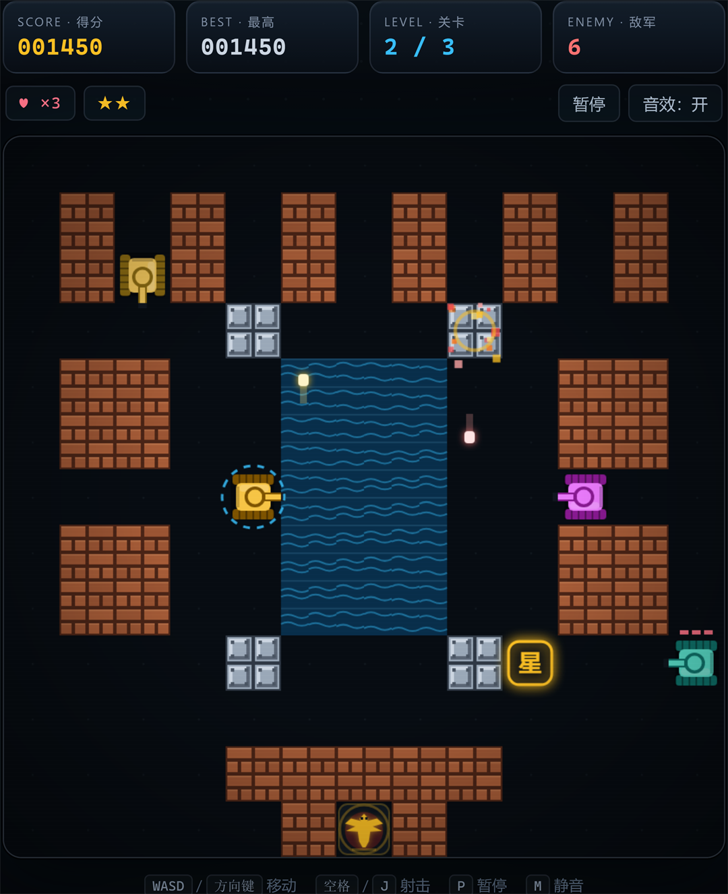

# 坦克大战 · Tank Battle

纯 HTML5 Canvas 打造的复古坦克大战：零依赖、零构建，打开浏览器就能玩。




## 特性

- **即开即玩**：原生 HTML + CSS + JavaScript，无框架、无依赖、无构建步骤
- **三关战役**：钢铁前哨、水域防线、丛林要塞，手绘 13×13 地图
- **敌军 AI**：普通、快速、火力、重甲四种坦克，会追击玩家、瞄准射击
- **成长系统**：拾取星星升级火力，提升弹速、射速与同时在场子弹数，满级可击穿钢板
- **四种道具**：护盾、火力星、额外生命、全屏轰炸
- **可破坏地形**：砖墙、钢板、水域、草丛，不同地形有不同阻挡规则
- **全平台适配**：键盘操作 + 手机触屏方向键，响应式布局
- **芯片音效**：WebAudio 实时合成，可一键静音
- **本地记录**：使用 localStorage 保存最高分与静音偏好

## 操作方式

| 操作 | 键盘 | 触屏 |
| --- | --- | --- |
| 移动 | `WASD` / 方向键 | 左侧方向键 |
| 射击 | `空格` / `J` | 右侧「发射」按钮 |
| 暂停 | `P` / `Esc` | 「暂停」按钮 |
| 静音 | `M` | 「音效」按钮 |
| 开始 / 继续 | `Enter` | 点击面板按钮 |

## 游戏规则

- 守住画面底部中央的基地（鹰徽），基地被摧毁即游戏结束。
- 消灭当前关卡全部敌军即可过关，剩余敌军数量显示在 HUD 中。
- 初始拥有 3 条命，被击中会损失一条命并在出生点复活，复活后短暂无敌。
- 击杀敌人有概率掉落道具，道具 14 秒后消失：
  - **护**：获得 8 秒无敌护盾
  - **星**：火力升级（最高 ★★，可击穿钢板）
  - **命**：生命 +1
  - **爆**：立即摧毁场上所有敌军
- 通关三关即可获得胜利。

## 关卡

| 关卡 | 名称 | 敌军数量 | 特色 |
| --- | --- | --- | --- |
| 1 | 钢铁前哨 | 8 | 砖墙迷宫，适合熟悉操作 |
| 2 | 水域防线 | 10 | 水域与钢板构成天然屏障 |
| 3 | 丛林要塞 | 12 | 大片草丛可隐藏行踪 |

## 本地运行

直接双击 `index.html` 即可游玩。

也可以启动一个本地静态服务器：

```bash
# Python 3
python -m http.server 8000

# 或使用 Node.js
npx serve .
```

然后访问 <http://localhost:8000>。

## 项目结构

```text
.
├── index.html      # 页面结构、HUD 与触屏控制
├── style.css       # 街机风格界面、响应式布局
├── game.js         # 游戏循环、碰撞、AI、渲染与音效
├── screenshot.png  # 游戏截图
├── LICENSE
└── README.md
```

## 技术实现

- Canvas 内部分辨率 416×416，按设备像素比渲染，高分屏下依然清晰
- 13×13 宏观网格（32px）与 26×26 瓦片网格（16px）构成双层地图
- AABB 碰撞检测、转角辅助移动、子弹分步推进避免高速穿透
- `requestAnimationFrame` 游戏循环，限制最大时间步长，不同刷新率下手感一致
- WebAudio 实时合成音效，不依赖任何外部音频资源
- 无任何第三方库或网络请求，可离线运行

## 浏览器支持

支持所有现代浏览器（Chrome、Edge、Firefox、Safari），同时适配桌面与移动端。

## License

[MIT](LICENSE) © 2026 xy1s555
